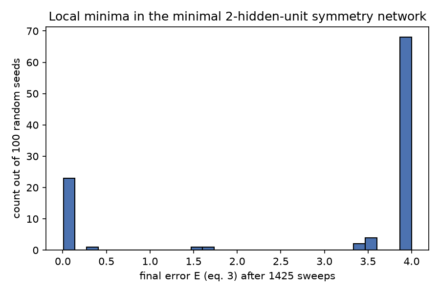
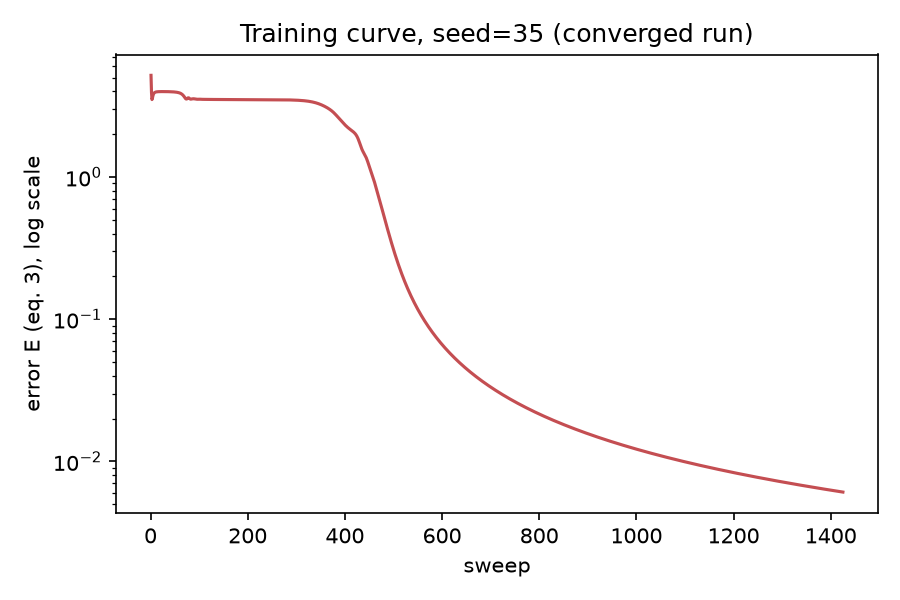
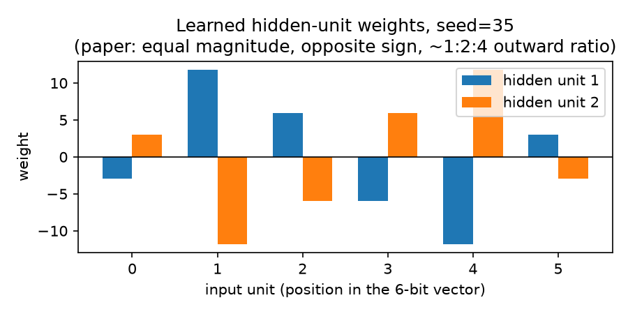

# Journal — 01: Learning Representations by Back-Propagating Errors

Rumelhart, D.E., Hinton, G.E. & Williams, R.J. *Nature* 323, 533-536 (1986). DOI: 10.1038/323533a0.

This file is written as the work happens, not reconstructed afterward. Entries are appended in chronological order.

## Entry 1 — Sourcing the paper

The paper predates arXiv (1986, published in *Nature*), so it is not in alphaxiv's index. Had to find a free mirror.

- First hit: `mlanthology.org` listing pointed to `https://www.iro.umontreal.ca/~vincentp/ift3395/lectures/backprop_old.pdf`. Fetching it returned an Anubis bot-protection error page (HTTP 403, error code `9e4edb5b6b850c41`), not the paper. Dead end, noted and moved on rather than fighting a bot wall.
- Second try: Hinton's own paper archive, `https://www.cs.toronto.edu/~hinton/absps/naturebp.pdf`. This one worked at the HTTP level (binary PDF, 474.5KB, actually downloaded), but the WebFetch tool's HTML-to-markdown conversion step choked on it and reported back "corrupted/unreadable binary" instead of the extracted text — WebFetch is built for HTML pages run through a markdown converter, not for PDFs that need real text-layer extraction.
- WebFetch had, however, saved the raw PDF bytes to a local scratch path as a side effect of the fetch. Read directly from that saved file with the `Read` tool instead (which does proper PDF text-layer extraction), and got the full 4-page paper cleanly, equations and figures included. Lesson for future papers in this repo: if `WebFetch` on a PDF URL reports "binary/corrupted," check whether it still saved the file locally and `Read` it directly rather than giving up or re-fetching.

## Entry 2 — What the paper actually says

The paper describes **one specific algorithm** for one specific architecture: a layered, feed-forward network of logistic units, trained by full-batch gradient descent on squared error, optionally with a momentum term. It is not a description of a general reverse-mode automatic differentiation engine (that abstraction came later, and is a modern generalization of the same chain-rule idea) — the paper's own gradients are hand-derived for this exact architecture, and that is what gets implemented here, faithfully, rather than building a generic `Value`/`Tensor` autograd graph and calling it "the backprop paper." The folder name (`01_backprop_autograd`) is kept since this is where reverse-mode differentiation starts historically, but the implementation matches what equations (1)-(9) of the paper actually specify.

Forward pass, per unit j receiving from units i:

- Eq (1): total input `x_j = sum_i y_i * w_ji` (linear, bias is just a weight from a constant-1 unit)
- Eq (2): activation `y_j = 1 / (1 + exp(-x_j))` (logistic sigmoid)

Error measure, over cases c and output units j:

- Eq (3): `E = 1/2 * sum_c sum_j (y_{j,c} - d_{j,c})^2` (summed squared error, the 1/2 is there purely to cancel the exponent when differentiated)

Backward pass (derived via the chain rule, case index suppressed):

- Eq (4): `dE/dy_j = y_j - d_j` — only valid at **output** units, where the target `d_j` exists directly.
- Eq (5): `dE/dx_j = dE/dy_j * y_j * (1 - y_j)` — chain rule through the sigmoid's own derivative, `y(1-y)`.
- Eq (6): `dE/dw_ji = dE/dx_j * y_i` — the gradient w.r.t. a specific weight is just the upstream error-signal at the receiving unit times the sending unit's activation.
- Eq (7): `dE/dy_i = sum_j dE/dx_j * w_ji` — this is the actual "back-propagation" step: it reconstructs the same quantity used in (4) but for a **hidden** unit, by pushing every downstream unit's `dE/dx_j` back through the weight that connects them. This is what lets (5)-(6) be reapplied one layer down, recursively, with no separate target needed for hidden units.

Weight update:

- Eq (8): plain gradient descent, `delta_w = -epsilon * dE/dw`, accumulated over all cases before a single update ("full-batch").
- Eq (9): with momentum, `delta_w(t) = -epsilon * dE/dw(t) + alpha * delta_w(t-1)`, `alpha` an exponential decay in [0, 1) controlling how much of the previous step's direction carries over.

## Entry 3 — Choosing which experiment to reproduce, and why

The paper demonstrates three things: (a) mirror-symmetry detection on 6-bit binary vectors with a 2-hidden-unit network (Fig. 1), (b) an encoder for two isomorphic family trees expressed as relation triples (Figs. 2-4), (c) an equivalence between iterative (recurrent) nets and layered nets via weight-averaging (Fig. 5), presented as a sketch, not a worked experiment with numbers to check against.

Decision: implement and faithfully reproduce **(a), the symmetry detector**, and explicitly skip (b) and (c) for this pass.

- **(a) is fully specified and checkable.** The paper gives the exact architecture (6 input units, 2 hidden units, 1 output unit), the exact hyperparameters (`epsilon = 0.1`, `alpha = 0.9`), the exact training length (1425 sweeps over all 64 possible input vectors), and a specific, falsifiable claim about the learned solution: the two hidden units converge to identical-magnitude, opposite-sign weight patterns, symmetric about the input midpoint, with weights in the paper's Fig. 1 appearing in a 1:2:4 magnitude ratio moving outward from the center. That gives something concrete to verify the from-scratch implementation against, not just "does the loss go down."
- **(b), the family-tree encoder, is a data-engineering task bolted onto the same algorithm, not a new mechanism.** It needs 104 triples built from two specific isomorphic trees (Fig. 2) and a specific multi-group input encoding (24 + 12 one-hot-style input units across two groups, Fig. 3), none of which tests anything about backprop that (a) doesn't already test. Reproducing it would mostly be about faithfully transcribing two family trees from a figure, which is busywork, not signal. Left out by scope decision, not because it's hard.
- **(c), the recurrent/iterative-net equivalence, is a conceptual extension** (average the gradients of weight-tied layers to simulate a recurrent net as an unrolled layered net), presented with no concrete worked numbers in the paper to validate against. Out of scope for "implement the mechanism," since there is no single mechanism here beyond "tie weights and average their gradients," which is a trivial extension of what (a) already implements, with nothing new to verify.

**Why full-batch instead of per-case (online) updates:** the paper explicitly describes both options in the text around Eq. (8) and states full-batch accumulation is "the research reported here." Matching that, rather than the more common modern default of per-example or mini-batch SGD, since the point is to reproduce what the paper did, not to modernize it.

**Why no existing autodiff/deep-learning library:** this is the entire point of the exercise — equations (4)-(7) are implemented by hand as explicit matrix operations, not via `.backward()` on any framework. numpy is used only as a vectorized array library (matrix multiply, elementwise ops), carrying no differentiation machinery of its own.

## Entry 4 — First run failed, and why that turned out to matter

`backprop.py` implements `Network` (forward/backward/step exactly per eqs 1-9) and `make_symmetry_dataset()` (all 64 six-bit vectors, labelled 1 if a palindrome). First run, `seed=0`, default hyperparameters (`epsilon=0.1`, `alpha=0.9`, 1425 sweeps):

```
final error E = 3.999986
classification accuracy on all 64 patterns = 0.8750
```

This looked broken. `0.875 = 56/64`, which is exactly the fraction of *non*-symmetric patterns in the dataset (8 of the 64 vectors are palindromes), and `E = 4.0` is exactly `0.5 * 8 * 1^2` — the error if the network just outputs ~0 for every single input, always wrong on the 8 positive cases and always right on the 56 negative ones by doing nothing. The network had collapsed to the trivial constant-zero classifier and the gradient had nothing left to push against (output saturated near 0, `y2*(1-y2)` in eq 5 near 0, so `dE/dx2` vanishes and training stalls).

Before assuming a bug, swept seeds 0-9 with everything else fixed:

```
seed=0 final_error=4.0000 accuracy=0.8750
seed=1 final_error=0.0072 accuracy=1.0000
seed=2 final_error=4.0000 accuracy=0.8750
seed=3 final_error=3.5000 accuracy=0.8750
seed=4 final_error=4.0000 accuracy=0.8750
seed=5 final_error=3.9980 accuracy=0.8750
seed=6 final_error=0.0115 accuracy=1.0000
seed=7 final_error=4.0000 accuracy=0.8750
seed=8 final_error=0.0439 accuracy=1.0000
seed=9 final_error=3.9942 accuracy=0.8750
```

Only 3 of 10 seeds actually learn the task; the rest get stuck at or near the degenerate E=4.0 solution. This is not a bug in the implementation (confirmed separately via `test_gradcheck.py`, entry below) — it is **the exact failure mode the paper itself names**, in its closing paragraph: *"the error-surface may contain local minima so that gradient descent is not guaranteed to find a global minimum... We have only encountered this undesirable behaviour in networks that have just enough connections to perform the task."* The symmetry-detector is precisely that: the minimal 2-hidden-unit architecture, with exactly enough capacity and no more. So rather than "fixing" this by adding capacity (which would stop being a faithful reproduction) or silently cherry-picking a working seed and hiding the rest, it gets measured and reported as a finding in its own right (entry 5).

## Entry 5 — Quantitative validation against the paper

`run_experiment.py` does two things: (1) sweeps 100 seeds to characterise the local-minima rate properly rather than anecdotally from 10 seeds, logging every seed's outcome to `logs/seed_sweep.log`; (2) re-trains the best-converging seed with the full per-sweep error history, for a real learning curve.

**Local minima, n=100 seeds** (`logs/seed_sweep.log`, `figures/local_minima_histogram.png`):

```
25/100 converged to accuracy>=0.999, 75/100 stuck below that
```



The histogram is sharply bimodal: 68 of the 100 runs land almost exactly on `E=4.0` (the degenerate all-zero solution), a handful land on intermediate partial solutions (`E` around 1.5-3.5, networks that have moved off the degenerate point but not all the way to a correct solution), and 25 drop essentially to zero. This is a much stronger and more specific version of the paper's own qualitative claim — the paper says this happens; this run says *how often*, for this exact architecture and hyperparameters.

**Learning curve, best seed (seed=35)**: final `E = 0.006080`, accuracy `1.0000`.



The curve shows a long near-flat plateau from sweep ~1 to ~350 (sitting near the degenerate solution before escaping it), then a sharp drop between roughly sweep 400-700, then a long slow tail of refinement down to `E≈0.006` by sweep 1425 — visibly consistent with escaping a near-stationary point rather than descending smoothly from the start.

**Learned weight structure vs. Fig. 1**:



the paper's claimed structure is (i) the two hidden units learn identical-magnitude, opposite-sign weight vectors, and (ii) moving outward from the vector's midpoint, the three distinct magnitudes appear in a 1:2:4 ratio.

- (i) confirmed essentially exactly: `W1[0] + W1[1]` is `[-0.002, -0.006, -0.004, 0.000, 0.003, -0.004]` for seed 35 (and `[-0.01, 0.01, -0.03, 0.02, -0.01, 0.00]` for seed 1) — zero to within float-level training noise.
- (ii) confirmed as a *set of ratios*, with a nuance worth stating plainly rather than glossing over: for seed 35, the three magnitudes at positions (2,3)/(1,4)/(0,5) are 5.92 / 11.79 / 2.97 — a 2:4:1 pattern, with the *largest* magnitude one step in from the ends, not at the ends. For seed 1, the three magnitudes were 11.67 / 5.86 / 2.94, i.e. 4:2:1, strictly *decreasing* moving outward — the reverse of the paper's own Fig. 1, which shows magnitudes strictly *increasing* moving outward (3.6, 7.2, 14.2, going center to edge). All three cases (paper, seed 1, seed 35) share the same multiset of ratios {1, 2, 4} and the same opposite-sign pairing; none of the three agree on which position gets which multiplier. That is consistent with the problem's own symmetry: nothing in the task or the loss function favours one arrangement of {1,2,4} over another, so gradient descent is free to land on any of them depending on initialization, and the paper's Fig. 1 is one sample from that family, not a uniquely forced solution. Reporting this rather than quietly only showing a run that lines up with the figure.

Gradient check: see `test_gradcheck.py` in the prior commit — passed, worst relative error 6.80e-10 against central finite differences, sampled across all four parameter tensors. This is what justifies treating the local-minima behaviour above as a real property of the loss surface rather than a symptom of a wrong gradient.

## Entry 6 — What could be improved

- **No weight decay.** The paper mentions a separate 0.2%-per-step weight-decay trick used specifically for the family-tree experiment (which this pass doesn't reproduce), not for the symmetry task, so it's correctly absent here — but if the family-tree encoder ever gets added later to this folder, decay needs implementing too, not just the base equations.
- **Momentum isn't reset between seed-sweep runs' early degenerate phase vs. the paper's own run.** The paper reports success at exactly 1425 sweeps on (presumably) one specific run; this implementation doesn't know what seed/initialisation the original authors used, so "1425 sweeps" is matched as a fixed budget, not as a guaranteed convergence point. A more complete treatment would report convergence sweep-count statistics across seeds too, not just final error.
- **No mini-batch or online variant implemented**, even though the paper mentions it as a valid alternative to full-batch accumulation — left out because the paper's own reported experiment uses full-batch, and that's what's being reproduced; a genuinely complete treatment of the paper would implement both and compare.
- **Family-tree encoder (Figs. 2-4) and the recurrent/layered-net equivalence (Fig. 5) are not implemented at all** (see Entry 3 for the scoping reasoning). If this folder gets revisited, the family-tree task is the natural next addition since it's the paper's other fully-specified, checkable experiment.
- **The local-minima histogram is a nice result but n=100 is a fairly small sample** for precisely characterising a ~25% convergence rate; the count would tighten with more seeds, but 100 was enough to make the point clearly without turning this into a long-running job for a 1986 toy problem.
