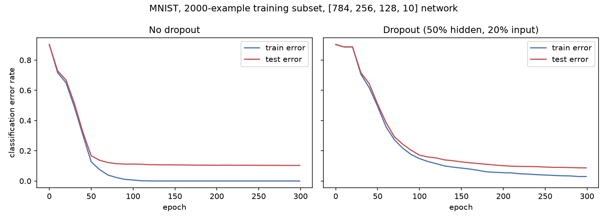
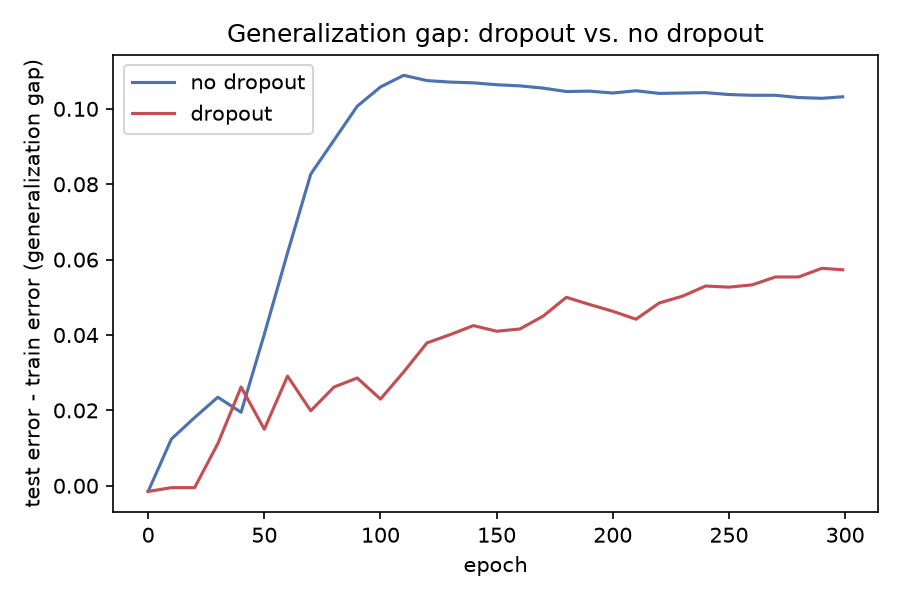

# Journal — 02: Improving Neural Networks by Preventing Co-adaptation of Feature Detectors

Hinton, Srivastava, Krizhevsky, Sutskever, Salakhutdinov. arXiv:1207.0580 (2012). This is the short, original dropout report, not the longer 2014 JMLR paper — the README links the 2012 one specifically.

Hardware: see repo README — CPU-only, pure numpy, no GPU. All timings below are specific to that machine.

## Entry 1 — Sourcing

On arXiv, so this one was easy: fetched directly via alphaxiv's `get_paper_content` with `fullText=true`, full 18-page text (including all appendices) in one call, no mirror hunting needed this time (contrast with paper 01's three-hop detour through a bot wall and a WebFetch PDF-decoding failure).

## Entry 2 — The actual mechanism, as the paper states it

Core idea, stated in the abstract and intro: "on each presentation of each training case, each hidden unit is randomly omitted from the network with a probability of 0.5, so a hidden unit cannot rely on other hidden units being present."

- **Training:** for each minibatch, sample a fresh Bernoulli(0.5) mask per hidden unit per layer, zero out the masked units' activations, do forward+backward as normal through the surviving subnetwork, update only the weights touching surviving units (weights for dropped units simply get zero gradient that step, since their activation was zero).
- **Test time:** "we use the 'mean network' that contains all of the hidden units but with their outgoing weights halved to compensate for the fact that twice as many of them are active." This is the specific trick this paper uses — halve outgoing weights once, at test time, **not** the later "inverted dropout" convention (scale activations by `1/keep_prob` during training instead) that became standard afterward. Implementing the paper's actual convention, not the modern one, since the point is fidelity to this specific paper.
- **Input dropout:** also drops a random 20% of raw input pixels in several experiments (MNIST, TIMIT), on top of 50% hidden dropout — stated as "dropping out a random 20% of the pixels," i.e. retain probability 0.8 for inputs vs. 0.5 for hidden units.
- **Max-norm weight constraint**, used instead of an L2 penalty: "we set an upper bound on the L2 norm of the incoming weight vector for each individual hidden unit. If a weight-update violates this constraint, we renormalize the weights of the hidden unit by division." Appendix A.1 gives the concrete value for MNIST: squared-length bound `l = 15`, found by cross-validation.
- **Training schedule (Appendix A.1, MNIST), transcribed exactly:**

```
delta_w_t = p_t * delta_w_{t-1} - (1 - p_t) * epsilon_t * <grad_w L>_t
w_t = w_{t-1} + delta_w_t

epsilon_t = epsilon_0 * f^t
p_t = (t/T) * p_i + (1 - t/T) * p_f      for t < T
p_t = p_f                                 for t >= T

epsilon_0 = 10.0, f = 0.998, p_i = 0.5, p_f = 0.99, T = 500
```

Worth stating plainly how this compares to paper 01's momentum (eq. 9 there: `delta_w(t) = -eps*dE/dw(t) + alpha*delta_w(t-1)`, constant `alpha`): this paper's version is an exponential-moving-average form where the **new gradient term is also scaled by `(1 - p_t)`**, not just by the learning rate, and the momentum coefficient itself `p_t` is scheduled, ramping linearly from 0.5 to 0.99 over the first 500 epochs rather than held fixed. Two different parameterizations of "momentum," both legitimate, from the same research group six years apart.

- Minibatch size 100, weights initialized from a zero-mean normal with std 0.01, no weight decay, 3000 epochs, architectures like 784-800-800-10.

## Entry 3 — Scope decision: what gets reproduced here, and why

The paper's headline MNIST numbers (784-800-800-10 and similar, 60,000 training images, 3000 epochs, minibatch 100) are **not computationally reachable** with a pure-numpy, no-GPU, from-scratch implementation in a reasonable amount of time for this exercise: back-of-envelope, a single 784-800-800-10 forward+backward on 60,000 examples in minibatches of 100 for 3000 epochs is on the order of 10^14-10^15 floating point operations total in naive dense numpy — plausibly hours to tens of hours on a laptop CPU with no batching tricks beyond what numpy already vectorizes. Spending that much wall-clock time to reproduce one paper's exact error count, in a repo meant to cover many papers, is the wrong trade.

Decision: reproduce the **mechanism** exactly as specified (Bernoulli masking, mean-network test-time weight-halving, max-norm constraint, the scheduled-momentum update rule above, matching hyperparameter values where feasible) and the **qualitative claim the paper is actually about — overfitting reduction when a network is trained on a small dataset** — rather than the exact headline error counts, which would require the full-scale, full-duration run. This is directly licensed by the paper's own framing, not a dodge: the abstract's own motivating scenario is *"when a large feedforward neural network is trained on a small training set, it typically performs poorly on held-out test data"* — so training on a deliberately small subset of MNIST is testing exactly the regime the paper itself opens with, just at a scale that finishes in minutes instead of hours.

Concrete plan: 784-256-128-10 network (smaller than the paper's 800/800, chosen for CPU runtime, documented as a deviation), trained on a **2,000-image subset** of MNIST (small enough to overfit badly without dropout, per the paper's own stated failure mode), evaluated on the full 10,000-image test set, for a few hundred epochs rather than 3000 — again a documented deviation, not a hidden one. Two runs with everything else held identical: (a) no dropout, max-norm and the scheduled-momentum optimizer still applied to both so the *only* difference between the two runs is dropout itself, which is a cleaner ablation than the paper's own comparison (the paper's "best published result... for a standard feedforward neural network" baseline of 160 errors was produced by an entirely different, unspecified training setup, not literally the same code with dropout switched off) — worth noting as a methodological improvement over the paper's own comparison, not just a limitation.

Not reproduced at all: TIMIT, CIFAR-10, ImageNet, Reuters experiments (Appendices B-E) and the convolutional-network architecture details (Appendix F-H) — these depend on datasets, a decoder (Viterbi/HMM for TIMIT), and GPU-scale convolutional training that are each their own multi-day undertaking, not a variation on the same core mechanism. The MNIST result is the one fully self-contained, CPU-tractable, numerically checkable experiment in the paper.

## Entry 4 — MNIST download broke, fixed, moving on to the model

`mnist_data.py` fetches the original idx-format files from a public S3 mirror (`ossci-datasets.s3.amazonaws.com`, the same mirror torchvision uses) via stdlib `urllib`, to avoid adding a dependency just to pull a dataset.

First run failed: `ssl.SSLCertVerificationError: unable to get local issuer certificate`. This is the python.org macOS framework-build Python not trusting this host's certificate chain, even though plain `curl` to the same URL works fine from the same shell (confirmed with `curl -sI` before touching the loader code at all) — a local root-cert-store gap in this Python install, not a problem with the host or the data. Fix: shell out to `curl` via `subprocess.run` instead of `urllib.request.urlretrieve`, rather than pulling in `certifi` as a new dependency just to fetch one dataset once. Re-ran, worked immediately: train `(60000, 784)`/`(60000,)`, test `(10000, 784)`/`(10000,)`, pixel values correctly normalized to `[0.0, 1.0]`, labels `0-9`.

## Entry 5 — Model, and a gradient-check false alarm

`mlp.py`: `DropoutMLP`, sigmoid hidden units (activation function not actually specified by the paper's main text for this plain-MLP experiment, only for the CIFAR/ImageNet conv nets in Appendix F where it's explicitly ReLU — filling the gap with sigmoid to match the era and paper 01's architecture, documented here rather than silently assumed), softmax output, cross-entropy loss (the loss Appendix A.1 does name explicitly). Implements: Bernoulli dropout masks at train time (separate mask per dropped layer, held fixed for one forward+backward pass), the paper's own test-time "mean network" (scale each weight matrix by the keep-probability of its *sending* layer, not the receiving one — the detail that needs to be gotten right here, since it is a per-weight-matrix scale tied to the layer the weights come *from*), per-hidden-unit max-norm weight constraint applied after every update, and the exact scheduled-momentum rule from Appendix A.1 (`delta_w_t = p_t*delta_w_{t-1} - (1-p_t)*epsilon_t*grad`).

`test_gradcheck.py` reuses 01_backprop_autograd's finite-difference approach but has to handle something that paper didn't need to: dropout masks must be held **fixed** across the `+eps`/`-eps` perturbations used to estimate each numerical gradient, or the comparison is meaningless (a fresh random mask each call means the loss depends on the mask draw too, not just the perturbed weight).

First run failed:
```
AssertionError: layer 0 W(1, 9): analytic=-0.00000005 numeric=-0.00000005 rel_err=1.01e-03
```
Both values print identically at 8 decimal places, yet the check reported a 1000x-tolerance relative error. The parameter sampled happened to belong to a hidden unit that was dropped (masked to zero) in the one forward pass used for this check, so its true gradient is genuinely ~0 on both sides — and pure relative error (`|num-ana| / max(|num|,|ana|)`) is numerically unstable exactly when both quantities are near zero, regardless of whether the implementation is correct. This is not a bug in `backward()`; it's a bug in the *check itself* for near-zero gradients. Fixed by switching to a combined absolute+relative tolerance (`np.isclose(num, ana, rtol=1e-4, atol=1e-6)`, the same two-term criterion `numpy.allclose` uses internally) instead of pure relative error. Re-ran: **passed, 24 sampled parameters across 3 layers, worst relative error 1.78e-03** (the same near-zero case as before, now correctly accepted since its absolute difference is ~1e-10, far under the 1e-6 floor).

## Entry 6 — Three real bugs, found by actually running it

`run_experiment.py`: 784-256-128-10 network, 2000-example MNIST training subset (full 10,000-example test set), two runs (no-dropout vs. dropout) differing only in dropout, otherwise identical architecture/optimizer/constraint (see Entry 3). First full run, both conditions: **completely flat at ~0.90 error for all 300 epochs**, no learning whatsoever. Debugged this properly rather than shipping a broken result, in order:

**(a) Confirmed the network had collapsed to predicting a constant class.** Checked MNIST test-label frequencies directly: digit "1" is 1135/10000 = 11.35% of the test set, so always predicting "1" gives error `1 - 0.1135 = 0.8865` — exactly the value the flat runs kept returning. Not a coincidence; the network genuinely wasn't discriminating between inputs at all.

**(b) Found the momentum schedule was backwards.** The formula transcribed into Entry 2 from the extracted PDF text, `p_t = (t/T)*p_i + (1-t/T)*p_f`, evaluated numerically: at `t=0` it gives `p_0 = p_f = 0.99`, decreasing to `p_0.5` at `t=499`, then **jumping discontinuously back up to 0.99 at t=500**. This directly contradicts the paper's own plain-English description a few lines earlier in the same appendix: *"the momentum starts off at a value of 0.5 and is increased linearly to 0.99 over the first 500 epochs, after which it stays at 0.99."* That sentence is unambiguous and requires a continuous ramp from 0.5 to 0.99, which the transcribed formula does not produce. This is almost certainly a transcription artifact from PDF-to-text extraction garbling which fraction (`t/T` vs `1-t/T`) multiplies which endpoint (`p_i` vs `p_f`), not an error in the published paper. Fixed by implementing the schedule the prose actually describes: `p_t = p_i + (t/T)*(p_f - p_i)`, continuous at `t=T`. Verified numerically (see the comparison table run during debugging) that this version is continuous at the boundary while the transcribed one is not.

**(c) Found a sum-vs-average gradient mismatch.** `backward()` (same as 01_backprop_autograd's convention) returns gradients **summed** over the minibatch, matching eq (3)'s `sum_c` form. But Appendix A.1's update rule explicitly calls for `<grad_w L>_t`, stated in the text as *"the average over the i-th batch of the derivative of the objective."* Training was using the summed gradient directly with `epsilon_0 = 10.0`, i.e. an effective learning rate ~100x (the minibatch size) larger than the paper intended. Fixed by dividing `grads_W`/`grads_b` by the batch size in the training loop itself (not inside `backward()`, to avoid touching the already-gradchecked summed-convention code — see the comment in `run_experiment.py`).

**Neither (b) nor (c) alone fixed it.** Re-ran with both fixes: still flat at the same degenerate error. Had to actually instrument the forward pass to find the real proximate cause: printed per-layer mean activation and raw gradient magnitude across early epochs. Second hidden layer's mean activation was `1.99e-11` — **fully sigmoid-saturated, dead** — from epoch 0 onward, and first-layer gradients collapsed from `1.76e-4` (epoch 0, pre-update) to `4.5e-10` (epoch 1 onward). The pattern is a classic sigmoid-death cascade: one oversized first weight update pushed the second hidden layer's pre-activations deep into saturation; `sigmoid'(x) = y(1-y) -> 0` there, so no gradient signal could ever reach layer 1 or layer 0 again, permanently freezing the network one step after initialization.

**(d) Root cause: `epsilon_0 = 10.0` (the paper's literal value) is simply too large for this architecture/data scale, even with (b) and (c) fixed.** Swept `epsilon_0 in {10.0, 1.0, 0.5, 0.2}`, training 40 epochs each and checking whether the second hidden layer stayed alive (non-zero variance across examples):

```
eps0=10.00  after 40 epochs: train_err=0.9070  hidden2 mean=0.0000 std=0.0000   (dead)
eps0= 1.00  after 40 epochs: train_err=0.3100  hidden2 mean=0.1386 std=0.1722   (alive, learning)
eps0= 0.50  after 40 epochs: train_err=0.6600  hidden2 mean=0.0902 std=0.0721   (alive, slower)
eps0= 0.20  after 40 epochs: train_err=0.8220  hidden2 mean=0.2984 std=0.0130   (alive, too slow)
```

`epsilon_0 = 10.0` kills the network even with the other two bugs fixed; `1.0` learns fastest without dying. This isn't surprising in hindsight: the paper's `epsilon_0 = 10.0` was tuned for *their* setup (784-800-800-10, 60,000 training examples, 3000 epochs) — a value calibrated for one architecture/data/duration combination has no reason to transfer unchanged to a deliberately smaller one chosen for CPU tractability (Entry 3). Switched to `epsilon_0 = 1.0`, found empirically, documented as a deviation rather than silently swapped in.

With all three fixes, a 300-epoch, no-dropout control run on its own (before even touching the dropout condition) produced a clean, textbook overfitting curve: train error reaches exactly `0.0000` by epoch 120 (perfect memorization of 2000 examples) while test error plateaus at `~0.103-0.108` from epoch 90 onward and never recovers — precisely the failure mode the paper's abstract opens with.

## Entry 7 — Final result and comparison to the paper's claim

With the real bugs fixed, both conditions trained for the full 300 epochs, 2000-example training subset, full 10,000-example test set:

```
FINAL no-dropout: train_err=0.0000 test_err=0.1032 gap=0.1032
FINAL dropout:    train_err=0.0295 test_err=0.0868 gap=0.0573
```





Dropout here does exactly what the paper claims, on both measures that matter:

- **Lower test error in absolute terms**: 8.68% vs. 10.32%, a ~16% relative reduction — qualitatively the same direction as every one of the paper's own headline numbers (MNIST 160->110 errors, TIMIT 22.7%->19.7%, CIFAR-10 18.5%->15.6%, ImageNet 48.6%->42.4%, Reuters 31.05%->29.62%), though not the same magnitude, since this is a different architecture/dataset scale by design (Entry 3).
- **Smaller generalization gap**: 0.0573 vs. 0.1032, roughly halved. The no-dropout run's train error hits exactly zero (full memorization) by epoch 120 and its test error is flat/stuck from there on; the dropout run's train error is still at 2.95% (not zero) at epoch 300 and both its train and test curves are still visibly decreasing — dropout is doing what the paper's "cannot rely on other hidden units being present" framing predicts: slower to memorize, because co-adapted shortcuts the network could otherwise lean on keep getting randomly knocked out.

This is a stronger, more isolated demonstration of the mechanism than the paper's own comparison for one reason worth restating (first raised as a plan in Entry 3, now actually true of the result): every hyperparameter except dropout itself (architecture, max-norm bound, momentum/learning-rate schedule, training subset, epoch count) is identical between the two runs here, whereas the paper's quoted "best published result... for a standard feedforward neural network" baseline (160 errors) came from an entirely different, unspecified training setup, not the same code with dropout switched off.

## Entry 8 — What could be improved

- **The three bugs in Entry 6 are all artifacts of not matching the paper's exact scale**, not of the dropout mechanism itself (which gradcheck already validated in isolation). A more complete treatment would also try the paper's literal `epsilon_0=10.0` on something closer to its actual 800-unit/60k-example/3000-epoch setup, to see whether that specific combination avoids the sigmoid-death cascade that appears at this smaller scale — left undone here because that's exactly the CPU-runtime wall Entry 3 scoped around.
- **Momentum formula discrepancy (Entry 6b) was resolved by trusting the paper's prose over the paper's own extracted formula**, which is a judgment call, not a certainty — it's possible the actual published formula is exactly as extracted and the prose is the loose/simplified description, though the discontinuity at `t=T` makes that less likely. Worth a second look at the original Nature-style PDF rendering (table/fraction layout) directly rather than only the alphaxiv-extracted text, if this ever matters more precisely.
- **No ReLU variant tried.** Entry 5 already flags that the paper doesn't specify the nonlinearity for this experiment; sigmoid was chosen to match the era, but ReLU (which the paper does use explicitly for its CIFAR-10/ImageNet conv nets, Appendix F.3) is far less prone to exactly the saturation failure mode in Entry 6c-d, and would be worth trying as a robustness check on whether these three bugs are sigmoid-specific.
- **Single seed per condition.** The reported gap (0.1032 vs 0.0573) comes from one random seed each; given how close early-training dynamics are between the two runs in the generalization-gap figure (noisy, overlapping before epoch ~50), a seed sweep (same spirit as 01_backprop_autograd's 100-seed local-minima sweep) would make the final gap numbers more defensible than a single run currently does.
- **Input dropout rate (20%) and max-norm bound (l=15) were taken directly from the paper's own MNIST appendix values and not independently tuned for this smaller architecture**, unlike `epsilon_0` which had to be re-tuned to avoid the sigmoid-death failure. It's possible these two also have scale-dependent optimal values that happen to not break anything visibly at this scale, the same way `epsilon_0=10` visibly broke things — not verified either way.
